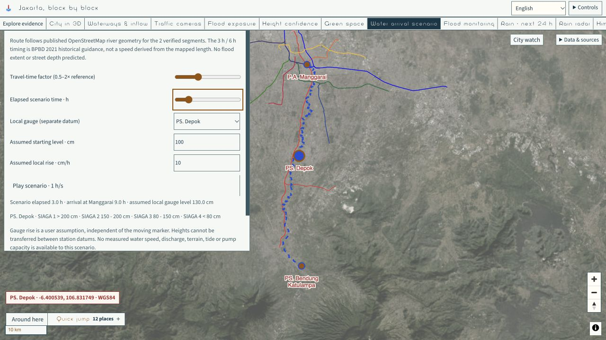

# Ciliwung southern-route receipt · 15 October 2026

The live arrival lens renders the mapped Ciliwung corridor south of the dashboard's earlier −6.4° latitude boundary. This is evidence of map coverage. The boundary is not a hydrologic threshold, catchment divide or flood-validation line.

## Live browser evidence

- URL: <https://jakarta.nonarkara.org/atlas?lang=en&lens=arrival>
- Build read from the actual page's script URLs: `jakarta-atlas-20261015-1792078238-cba230e`.
- Capture: `CILIWUNG-CUTOFF-LIVE-2026-10-15.png`, 1280 × 720, using CUA against the live custom domain.
- Screenshot SHA256: `f40b2ebcdde927bf23d9210f77e03593ad5a8dc801368d77971dddec57e0ca99`.
- Opened **Explore evidence**, selected **PS. Depok**, and set elapsed scenario time to **3.0 h** using the slider. Travel-time factor stayed **1×**; playback stayed stopped.
- The red location readout states **PS. Depok · −6.400539, 106.831749 · WGS84**. The map shows the labelled Depok point, the blue mapped corridor extending south to Katulampa, and the northern continuation to Manggarai. At the assumed 3 h timing, the moving marker is at Depok.
- The visible panel says that the route follows two verified OpenStreetMap geometry segments, the timing comes from historical BPBD guidance, and no flood extent or street depth is predicted. The assumed 130 cm gauge value shown in this receipt is a user scenario value, not an observation.

## Deployed geometry check

At `2026-10-15T15:51:09Z`, curl fetched both public assets over HTTPS without cache-key changes. Each matched the repository bytes exactly:

| Asset | Bytes | SHA256 |
| --- | ---: | --- |
| `ciliwung-route.geojson` | 52,886 | `1f4464ad2f176a7802395ec612a09059657ce86003b21fa05266fe7606aee739` |
| `ciliwung-manifest.json` | 1,671 | `76bdd3b04b47dfb93879acbc6b0db23e61060b62784be2a504289e2bacdab10d` |

The route carries these coordinate extrema, recomputed from every deployed vertex. Bounds use `[west, south, east, north]` in WGS84 degrees.

| Segment | Vertices | Vertices south of −6.4° | Bounds |
| --- | ---: | ---: | --- |
| Katulampa → Depok | 925 | 925 | `[106.7972207, −6.6336889, 106.8373591, −6.4005954]` |
| Depok → Manggarai | 1,167 | 1 | `[106.8289293, −6.4005954, 106.8669749, −6.2075414]` |

The second segment crosses −6.4° at approximately **106.83192305° E**, using linear interpolation between its adjoining WGS84 vertices. Both segments meet at `[106.8317448, −6.4005954]`. The published Depok station anchor is about 6.3 m from that mapped node; station coordinates and route nodes are separate evidence.

The existing `node scripts/test-ciliwung-route.mjs` passed. It recomputes admission gates and checks source anchors, vertex counts, bounded edges and retained raw Overpass evidence. The manifest states OSM base time `2026-10-13T11:26:47Z`, retrieval `2026-10-13T11:27:52Z`, ODbL and the mapped-river-reference tier. No new application code or source geometry was required for this receipt.

## Historical evidence limit

MiniMax reported duplicate receipts numbered 13/14 from the 13 October release. Their original file paths were not supplied and were not found in the repository's tracked documentation or the local `out` captures examined for this task. That historical duplication remains a reported issue, not independently verified here. No earlier screenshot was deleted or overwritten. This new receipt supplies a distinct, inspectable live state with the southern reference coordinate visible.

Geometry coverage does not establish current discharge, surveyed river capacity, measured water velocity, local datum compatibility, or calibrated travel time.
